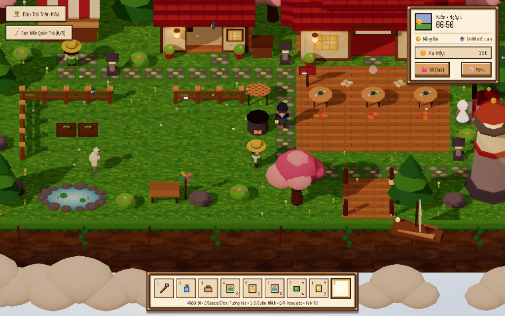
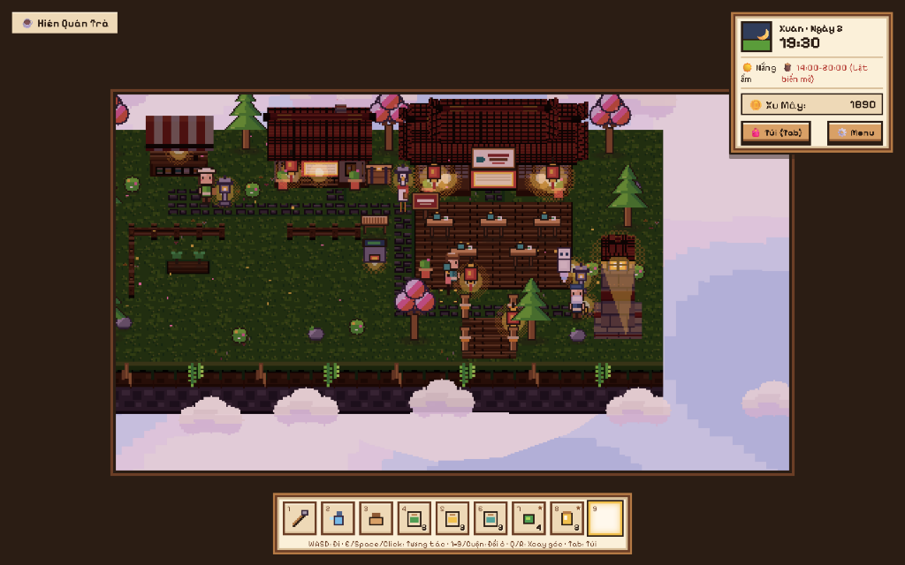
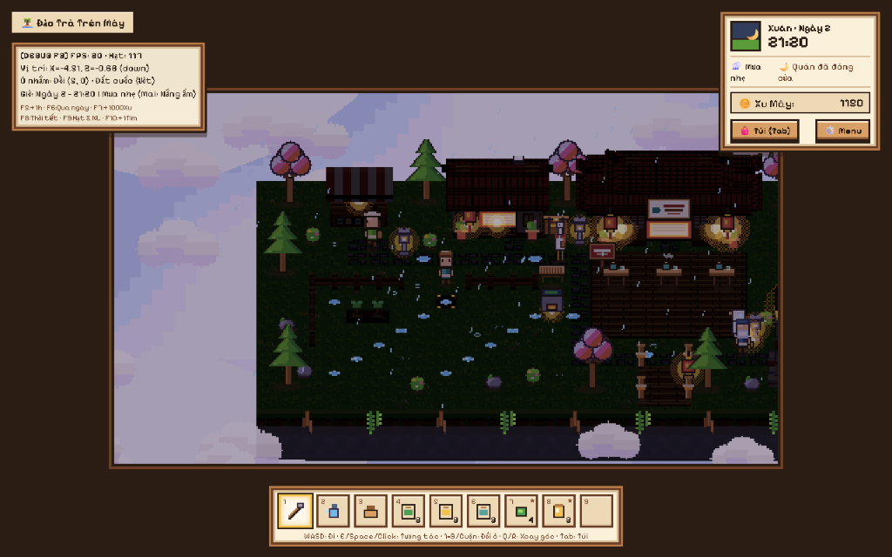

# 🍵 Trà Quán Trên Mây

> **Game mô phỏng quán trà & nông trại Stylized 3D phong cách Ghibli ấm áp.**  
> Bạn thừa kế một quán trà cũ của bà ngoại trên hòn đảo nổi giữa biển mây. Mỗi ngày, hãy tự tay cuốc đất, trồng trà và thảo mộc, phơi nắng, sao lá, pha nên những tách trà ấm thơm ngát để đón những vị khách lạc mây, khám phá các địa danh trên đảo và lắng nghe câu chuyện ký ức của cư dân.

---

## 📸 Hình ảnh trong game

### Đời sống ban ngày trên Đảo Mây — Phiên bản Stylized 3D Ghibli (Mùa Xuân)


### Hiên Quán Trà ấm áp về đêm (Nâng cấp 5 bàn & Đèn lồng)


### Đêm mưa nhẹ với vũng nước gợn sóng


---

## ✨ Tính năng nổi bật

- **Đồ họa Stylized 3D Cozy / Ghibli toàn diện:** Render full-resolution mượt (`antialias: true`), vật liệu cel/toon 4 dải sáng (`toonMaterials.ts`), 12 chất liệu cọ vẽ 256×256 (`meadowGrass`, `stonePath`, `woodDeck`, `roofTiles`, `plasterWall`, `shojiLit`, `cliffRock`, `soilTilled`, `soilWatered`, `waterPond`, `bambooWeave`, `woodFence`), đổ bóng mềm `PCFSoftShadowMap` (`2048×2048`), `ACESFilmicToneMapping`, `UnrealBloomPass` dịu nhẹ, vòm trời 3D, 36 cụm mây 3D bồng bềnh & 6 đảo mây xa có thác nước.
- **Thế giới Đảo Mây sống động & 3 Địa danh mới:** Bổ sung **🌊 Hồ Sương Mây** (cá koi bơi & hoa súng), **⛩️ Miếu Trà Cổ** (mái đỏ chóp vàng & cổng Torii), **🔭 Bờ Mây Ngắm Cảnh** (ghế gỗ & chong chóng quay), cùng cây anh đào/thông 3D, 160 khóm hoa dại, Thuyền Mây neo cạnh Bến Mây và 5 điểm dọn lá 3D trên hiên quán.
- **Nhân vật 3D & Chân dung Storybook:** Toàn bộ người chơi (`Mây`, `Cò Lữ`, `Ông Đăng`, `Bé Sương` và 4 kiểu khách) được dựng mô hình 3D cel-shaded có khớp chuyển động, kết hợp chân dung vẽ tay `128×128` (3 biểu cảm) và tranh cutscene `640×300` độ nét cao.
- **Trồng trọt 5 loại cây Mùa Xuân 3D:** *Trà Xanh Mây* (thu hoạch nhiều lần, mọc lại sau 2 ngày), *Hoa Cúc Vàng*, *Bạc Hà Gió*, *Hoa Nhài Đêm* và *Gừng Ấm Đất* với mô hình 3D 4 giai đoạn sinh trưởng đung đưa theo gió, dấu hiệu lấp lánh khi chín và cơ chế mưa tự tưới.
- **Chế biến & Pha trà thủ công:** Phơi lá trên **Nong Tre** qua đêm, **Sao Trà** trên chảo 3D nóng qua mini-game giữ nhịp cho chất lượng `★ / ★★ / ★★★`, và **Quầy Pha Trà** góc nhìn từ trên xuống cho phép phối nguyên liệu, nhiệt độ nước (`75°C / 90°C / 100°C`) và thời gian ủ để mở khóa **5 công thức chính + Trà Lạ** trong Sổ Công Thức.
- **Vận hành Quán Trà buổi chiều (`14:00–20:00`):** Lật biển mở quán đón khách từ Bến Mây, đọc gợi ý mơ hồ qua lời nói của khách để pha đúng tách trà, thu **Xu Mây** theo chất lượng và thái độ phục vụ.
- **4 Cư dân trên Đảo & Ký ức (`0–10♥`):** Đồng hành cùng **Mây**, **Cò Lữ**, **Ông Đăng** và **Bé Sương** với lịch trình sinh hoạt sáng/chiều/tối & trú mưa, hội thoại biến đổi theo ngữ cảnh không lặp, tặng quà 4 mức và các đoạn **cutscene ký ức** tại mốc `2 / 5 / 8 / 10♥`.
- **Kinh tế, Nâng cấp & Trang trí:** Mua hạt giống, mật ong rừng và 3 món đồ trang trí tại **Sạp Bé Sương** (`08:00–18:00`); mở khóa **Bình tưới đồng 3 ô**, **Mở rộng quán 3 → 4 → 5 bàn**, **Đồi trà 10×6**, ký gửi qua đêm ở **Hộp Bán Hàng** và xem kết toán cuối ngày.
- **Thời tiết & Âm thanh Web Audio:** Nghe **Đài Dự Báo** ngày mai trong Nhà Ở; trải nghiệm *Nắng ấm* (bướm, chim 3D vỗ cánh, cánh hoa rơi), *Mưa nhẹ* (hạt mưa xiên, vũng nước gợn sóng, tự tưới đất), *Sương mù* (biển mây dâng cao + hiệu ứng sương); kèm **3 giai điệu lo-fi/acoustic** ngày/đêm/mưa và SFX riêng cho từng thao tác & mặt đất.
- **Cốt truyện 28 ngày Mùa Xuân mở rộng:** Cảnh mở đầu Thuyền Mây 3 cảnh, chuỗi **7 lá thư từ bà ngoại** (kèm `letter_6_shrine` tại Miếu Trà Cổ & `letter_7_seasons`), đối thoại lore động tại từng địa danh, hướng dẫn lồng mượt 3 ngày đầu, sự kiện ngày `6 / 12 / 18`, **Tiệc Trà Trăng Non (Ngày 14 Xuân)**, **Lễ Hội Thả Đèn Mây (Ngày 24 Xuân)** và **Tổng Kết Mùa Xuân (Ngày 28)**.

---

## 🛠️ Cài đặt & Chạy

Yêu cầu: **Node.js 18+** và **npm**.

```bash
# 1. Cài đặt thư viện
npm install

# 2. Chạy môi trường phát triển (Dev Server)
npm run dev

# 3. Kiểm tra TypeScript & build bản Production vào dist/
npm run build

# 4. Chạy thử bản Production vừa build
npm run preview

# 5. Chạy thử bằng cửa sổ desktop Electron
npm run electron:preview

# 6. Đóng gói file .exe portable chạy trực tiếp trên Windows x64 (tạo release/TraQuanTrenMay.exe)
npm run build:exe
```

> **Chơi nhanh bằng file `.exe`:** Sau khi chạy `npm run build:exe` (hoặc tải bản phát hành), mở trực tiếp **`release/TraQuanTrenMay.exe`** để chơi độc lập không cần trình duyệt. Dữ liệu lưu game được giữ bền vững giữa các lần mở, hỗ trợ phím `F11` bật/tắt toàn màn hình.

---

## 🎮 Điều khiển

| Phím / Thao tác | Chức năng |
|---|---|
| `WASD` / Phím mũi tên | Di chuyển (8 hướng mượt, trượt dọc tường) |
| `E` / `Space` | Dùng công cụ, thu hoạch, phơi/sao, pha trà, phục vụ khách, nói chuyện NPC |
| `Chuột trái` | Tương tác ô đất / đối tượng trong tầm 1 ô hoặc tiếp tục hội thoại |
| `1–9` / `Lăn chuột` | Chọn ô vật phẩm trên Hotbar |
| `Q` / `R` | Xoay góc nhìn camera `90°` quanh đảo |
| `Tab` / `I` | Mở **Túi Đồ (24 ô Kéo-Thả), Sổ Công Thức, Quan Hệ NPC & Thư / Lịch Xuân** |
| `Esc` | Mở Menu Tạm Dừng / Cài Đặt hoặc đóng cửa sổ đang mở |

> **Chế độ phát triển (`npm run dev`):** Bộ phím kiểm thử debug (`F3` Overlay FPS/tọa độ, `F5` +1h, `F6` qua ngày, `F7` +1000 Xu Mây, `F8` đổi thời tiết, `F9` thêm nguyên liệu, `F10` +1 tim NPC) chỉ hoạt động khi chạy `vite` dev (`import.meta.env.DEV`) và **được vô hiệu hóa hoàn toàn ở bản build production** (`npm run build` / `npm run preview`).

---

## 🗂️ Kiến trúc mã nguồn

```text
src/
├── main.ts                      # Điểm khởi chạy ứng dụng
├── style.css                    # Kiểu dáng UI full-viewport, viền 9-slice, font tiếng Việt
├── art/
│   ├── palette.ts               # Bảng màu Ghibli / Cozy cố định toàn dự án
│   ├── pixelArtGenerator.ts     # Bộ sinh viền UI 9-slice, icon vật phẩm & họa tiết bổ trợ
│   ├── storybookArt.ts          # Chân dung vẽ tay 128×128 (3 biểu cảm) & tranh cutscene 640×300
│   └── toonMaterials.ts         # Vật liệu cel/toon 4 dải sáng & 12 texture cọ vẽ 256×256
├── core/
│   ├── AudioSystem.ts           # Nhạc nền Web Audio (ngày/đêm/mưa) & SFX
│   ├── Game.ts                  # Vòng lặp chính, EffectComposer (Bloom), bóng mềm & tương tác địa danh
│   ├── InputSystem.ts           # Bàn phím, chuột, hotbar, khóa phím debug theo DEV
│   ├── SaveSystem.ts            # Lưu/tải localStorage (v4) kèm kiểm tra tính toàn vẹn dữ liệu
│   └── TimeSystem.ts            # Đồng hồ 06:00–24:00, ánh sáng bầu trời/mặt trời/bloom theo giờ
├── data/
│   ├── crops.ts                 # Dữ liệu 5 cây trồng, vật phẩm & giá trị chất lượng
│   ├── customers.ts             # Ngoại hình khách vãng lai & lời gợi ý order mơ hồ
│   ├── dialogues.ts             # Hội thoại theo ngày, thời tiết, buổi tối & số tim
│   ├── economy.ts               # Giờ mở sạp, bảng giá nâng cấp, vùng đặt đồ trang trí
│   ├── islandMap.ts             # Bố cục bản đồ đảo 26×16, cây, đá, đèn, hàng rào
│   ├── npcs.ts                  # Hồ sơ 4 NPC, quà thích/ghét, lịch trình & ký ức
│   ├── recipes.ts               # 5 công thức pha trà & chuẩn hóa nguyên liệu tươi/khô
│   ├── story.ts                 # Cảnh mở đầu 3 cảnh, 7 lá thư, sự kiện Ngày 14 & Lịch 28 ngày Xuân
│   ├── types.ts                 # Khai báo kiểu TypeScript dùng chung
│   └── weather.ts               # Cấu hình 3 loại thời tiết & lời Đài Khí Tượng
├── entities/
│   ├── BillboardSprite.ts       # Khung thực thể 3D hỗ trợ mô hình nhân vật & bóng tiếp đất
│   ├── CharacterModel3D.ts      # Bộ dựng mô hình nhân vật 3D cel-shaded & công cụ cầm tay
│   ├── Customer.ts              # Khách hàng 3D đi từ Bến Mây, bong bóng trạng thái
│   ├── NPC.ts                   # 4 cư dân đảo 3D đi tuần tra & đổi lịch trình theo thời tiết/giờ
│   └── Player.ts                # Điều khiển người chơi 3D, animation đi bộ & vung công cụ 3D
├── systems/
│   ├── BrewingSystem.ts         # Logic khớp công thức, chất lượng trung bình & Sổ Công Thức
│   ├── FarmingSystem.ts         # Cuốc, gieo, tưới (1 ô / 3 ô đồng), lớn theo ngày & thu hoạch
│   ├── ProcessingSystem.ts      # Nong tre phơi lá & Chảo sao tính chất lượng ★–★★★
│   ├── RelationshipSystem.ts    # Thân thiết 0–10 tim, tặng quà & ký ức chống lặp thoại
│   ├── ShopSystem.ts            # Vận hành Quán trà 14:00–20:00, lượt khách & trả thưởng
│   └── WeatherSystem.ts         # Hạt mưa/sương mù/cánh hoa/đom đóm/chim 3D & đèn trời 3D
├── ui/
│   ├── BrewingScreen.ts         # Màn pha trà nhìn từ trên xuống & mini-game Chảo sao
│   ├── DialogueBox.ts           # Hộp thoại NPC có chân dung 128×128 & tặng quà nhanh
│   ├── HUD.ts                   # HUD ngày/giờ, vị trí, gợi ý mục tiêu, hotbar & pop-up
│   ├── InventoryModal.ts        # Túi 24 ô kéo-thả, Sổ Công Thức, Quan Hệ, 7 Thư & Lịch Xuân
│   ├── ShopAndMenuModal.ts      # Sạp Bé Sương, Hộp Bán Hàng, Tóm tắt ngày, Menu & Cutscene 640×300
│   └── UIManager.ts             # Điều phối overlay, tiêu đề game & hiệu ứng ngủ qua ngày
└── world/
    ├── Buildings.ts             # Nhà Ở & Quán Trà 3D mái cong, Sạp, Hải Đăng, Thuyền Mây & vùng Địa danh
    ├── CloudSea.ts              # Vòm trời 3D, biển mây shader, 36 cụm mây 3D & 6 đảo xa có thác nước
    ├── Island.ts                # Đảo cỏ 3D liền mạch, vách đá, 3 địa danh mới & 160 cụm hoa dại
    └── Tiles.ts                 # Lưới đất trồng 3D nổi `10×6` ô, 5 cây 3D 4 giai đoạn & vũng mưa
```

---

## 📦 Công nghệ sử dụng

- **Three.js** (`^0.170.0`) — Dựng cảnh Stylized 3D cel/toon shading, `EffectComposer` + `UnrealBloomPass` + `PCFSoftShadowMap`.
- **TypeScript** (`^5.6.3`) — Kiểm tra kiểu nghiêm ngặt toàn bộ dữ liệu và logic.
- **Vite** (`^6.0.0`) — Môi trường phát triển nhanh & đóng gói production tách chunk `three` riêng biệt.
- **Electron** (`^39.8.10`) — Đóng gói ứng dụng desktop & file thực thi portable Windows x64 (`release/TraQuanTrenMay.exe`).
- **Web Audio API** — Tổng hợp 100% nhạc nền và hiệu ứng âm thanh không cần tải tệp audio rời.
